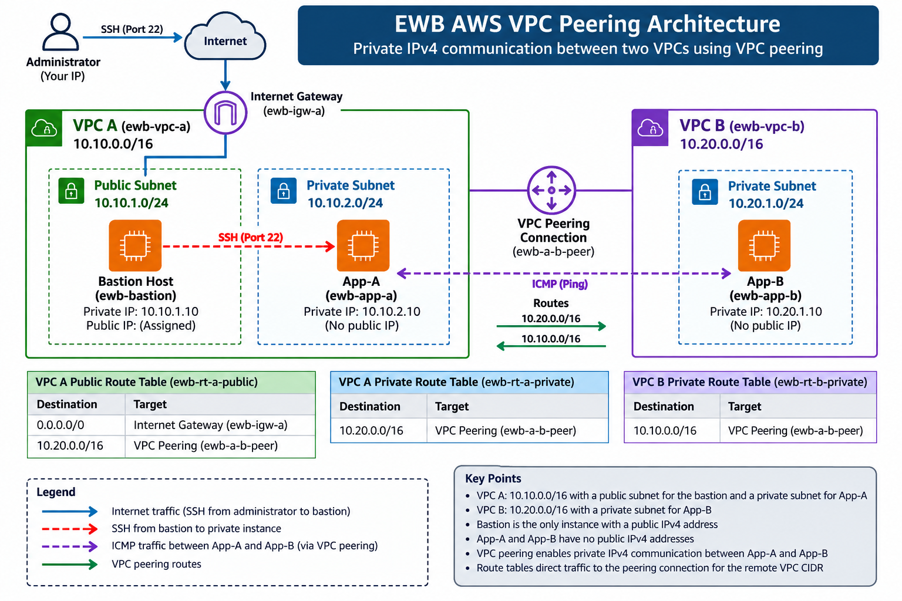

# EWB-AWS-VPC-Peering
Documented AWS VPC Peering student project with infrastructure configuration, routing, security rules, and validation instructions.
AWS VPC Peering — Private Connectivity Lab

Student: Thakur Sejal
Course: AWS Architect Associate — EWB Courses Student Project
Region planned: Asia Pacific (Mumbai) — "ap-south-1"
Project type: AWS networking practical

Project Overview

This project follows the EWB AWS VPC Peering Student Project workbook. It defines a network design that connects two non-overlapping Amazon VPCs through VPC peering, while keeping both application servers private.

The design uses a public bastion host for administration, explicit subnet route-table associations, restricted security-group rules, and private IPv4 connectivity between workloads.

«Implementation status: This repository contains the project design and reproducible configuration plan. Live AWS deployment and connectivity tests are not yet verified. Test results will be updated only when supported by actual execution evidence.»

Architecture

                       Administrator
                             |
                         SSH / 22
                             |
                    Internet Gateway
                             |
       VPC A: 10.10.0.0/16  |
    +------------------------------------+
    | Public subnet: 10.10.1.0/24        |
    | Bastion: 10.10.1.10                 |
    |                |                    |
    | Private subnet: 10.10.2.0/24        |
    | App-A: 10.10.2.10                   |
    +------------------+-----------------+
                       |
                  VPC Peering
                       |
    +------------------+-----------------+
    | VPC B: 10.20.0.0/16                 |
    | Private subnet: 10.20.1.0/24        |
    | App-B: 10.20.1.10                   |
    | No public IPv4 address              |
    +-------------------------------------+

The diagram represents the intended design, not a screenshot of a deployed AWS environment.

Network Address Plan

Resource| CIDR / Private IP
"ewb-vpc-a"| "10.10.0.0/16"
"ewb-a-public"| "10.10.1.0/24"
"ewb-a-private"| "10.10.2.0/24"
"ewb-vpc-b"| "10.20.0.0/16"
"ewb-b-private"| "10.20.1.0/24"
"ewb-bastion"| "10.10.1.10"
"ewb-app-a"| "10.10.2.10"
"ewb-app-b"| "10.20.1.10"

Planned AWS Resources

- Two VPCs with non-overlapping IPv4 CIDRs
- Three subnets: one public and two private
- One internet gateway attached to VPC A
- Three explicitly associated route tables
- One VPC peering connection
- Three EC2 instances running Amazon Linux 2023
- Three security groups with restricted inbound access
- One EC2 key pair for SSH access

Routing Design

Route table| Destination| Target
"ewb-rt-a-public"| "10.10.0.0/16"| Local
"ewb-rt-a-public"| "0.0.0.0/0"| Internet gateway
"ewb-rt-a-public"| "10.20.0.0/16"| VPC peering
"ewb-rt-a-private"| "10.10.0.0/16"| Local
"ewb-rt-a-private"| "10.20.0.0/16"| VPC peering
"ewb-rt-b-private"| "10.20.0.0/16"| Local
"ewb-rt-b-private"| "10.10.0.0/16"| VPC peering

The peering routes require an accepted, active peering connection. The actual route target must use the connection's assigned "pcx-..." ID.

Security Design

- Bastion SSH: TCP 22 from the administrator's current public IPv4 "/32".
- App-A SSH: TCP 22 from bastion private IP "10.10.1.10/32".
- App-B SSH: TCP 22 from bastion private IP "10.10.1.10/32".
- App-A ICMP echo requests: allowed from App-B "10.20.1.10/32".
- App-B ICMP echo requests: allowed from App-A "10.10.2.10/32".
- App-A and App-B must not have public IPv4 addresses.
- No SSH or ICMP inbound rules should use "0.0.0.0/0".

Validation Plan

The following checks are required before marking the practical complete:

1. Confirm the baseline ping fails before peering routes are configured.
2. Confirm App-A can ping App-B after peering and route configuration.
3. Confirm App-B can ping App-A.
4. Confirm SSH access to App-B through the bastion using SSH ProxyJump.
5. Confirm both application instances have no public IPv4 address.
6. Remove the relevant ICMP rule temporarily and verify failure, then restore it and verify recovery.
7. Record actual resource IDs, route-table associations, and cleanup evidence.

Status: These are planned acceptance tests, not claimed results. Evidence will be added after execution.

Repository Structure

EWB-AWS-VPC-Peering/
├── README.md
├── architecture/
├── terraform/
├── aws-cli/
├── security/
├── tests/
├── screenshots/
└── report/

Cost and Cleanup

This design does not require a NAT gateway. EC2 instances, storage, and public IPv4 usage may incur charges in a real AWS account. Deploy only in an authorized environment after checking pricing and credits. After testing, remove the lab instances, storage, peering connection, routes, security groups, subnets, route tables, internet gateway, and VPCs.

Learning Objectives

- Understand VPC CIDR planning and non-overlapping networks.
- Configure subnet associations and route-table entries.
- Explain forward and return routing through VPC peering.
- Restrict SSH and ICMP using least-privilege security-group rules.
- Validate private connectivity and troubleshoot failures.
- Document reproducible infrastructure and clean up resources responsibly.

References

- "VPC peering basics" (https://docs.aws.amazon.com/vpc/latest/peering/vpc-peering-basics.html)
- "Create a VPC peering connection" (https://docs.aws.amazon.com/vpc/latest/peering/create-vpc-peering-connection.html)
- "Update route tables for peering" (https://docs.aws.amazon.com/vpc/latest/peering/vpc-peering-routing.html)
- "Security groups for peered VPCs" (https://docs.aws.amazon.com/vpc/latest/peering/vpc-peering-security-groups.html)
- "Amazon VPC pricing" (https://aws.amazon.com/vpc/pricing/)

## Architecture Diagram

The project uses VPC peering to enable private IPv4 communication between two VPCs. A bastion host in VPC A provides controlled SSH access to private EC2 instances.

## Key Security Controls

- SSH access to the bastion is restricted to the administrator's public IP.
- App-A and App-B do not require public IPv4 addresses.
- Private workloads communicate through VPC peering and explicit route-table entries.
- Security groups restrict SSH and ICMP traffic to specified sources.

## Documentation

- [Architecture and IP Address Plan](docs/architecture.md)
- [Connectivity Validation Checklist](docs/validation-checklist.md)
- [Project Report](docs/project-report.md)
- [Terraform Configuration Guide](terraform/README.md)

## Important

Run the connectivity tests and record the actual results before submitting the final report. Remove all AWS resources after testing to avoid ongoing charges.

